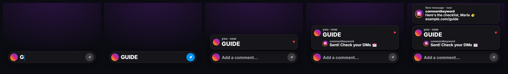

# Comment-to-DM call to action for Remotion

An animated "comment the keyword, get the DM" box for the end of a Reel, TikTok or Short, made with [Remotion](https://www.remotion.dev). It shows viewers what to do and what they'll get back, using your real automation:

1. An Instagram-style comment bar appears.
2. The keyword types in, and the send button lights up.
3. The comment posts.
4. Your account's public reply lands under it, with your profile picture.
5. The DM arrives: "New message · youraccount" and its text.




The reply, the DM, the handle and the picture come from your [CommentKeyword](https://commentkeyword.com/instagram-mcp-server) automation, so the video never promises a reply the account doesn't send. Without CommentKeyword, pass the texts as props and it works as a plain animated CTA.

## Files

| File | What it is |
|---|---|
| [`CommentBox.tsx`](CommentBox.tsx) | The component. Depends only on `remotion`. Colours, labels, fonts, texts and timing are props, and it scales with the composition width. |
| [`commentkeyword.mjs`](commentkeyword.mjs) | A read-only helper and CLI (Node 18+, no dependencies). It reads the keyword's automation and your connected Instagram account from the CommentKeyword API and prints the props. |
| [`Example.tsx`](Example.tsx) | A 1080×1920 composition: the box over a background, with optional sound effects on its beats. |

## Use it

Copy the three files into your Remotion project (for example `src/comment-box/`). The example uses `@remotion/google-fonts`:

```bash
npm i @remotion/google-fonts
```

Register the example in `Root.tsx`:

```tsx
import { Composition } from "remotion";
import { CommentBoxDemo } from "./comment-box/Example";

<Composition id="CommentBoxDemo" component={CommentBoxDemo} width={1080} height={1920} fps={30}
  durationInFrames={150} defaultProps={{ keyword: "GUIDE", reply: "Sent! Check your DMs 📩",
  dm: "Here's the checklist 👉 example.com/guide", replyHandle: "youraccount" }} />
```

Or place the box at the end of your own video:

```tsx
import { Sequence } from "remotion";
import { CommentBox } from "./comment-box/CommentBox";

<Sequence from={Math.round(27 * fps)} durationInFrames={Math.round(4.5 * fps)}>
  <CommentBox {...props} cps={12} fontFamily={fontFamily} />
</Sequence>
```

## Fill it from your automation

1. Create the automation first: in CommentKeyword, or by asking your agent with the [MCP server](../../README.md) ("anyone who comments GUIDE on my next Reel gets the checklist by DM").
2. Read it into props. You need an API token from **Settings → API** with `keywords:read`:

   ```bash
   COMMENTKEYWORD_API_TOKEN=YOUR_TOKEN node src/comment-box/commentkeyword.mjs GUIDE --name Maria > props.json
   npx remotion render CommentBoxDemo out/cta.mp4 --props=props.json
   ```

   `props.json` holds `keyword`, `reply`, `dm`, `replyHandle` and `replyAvatarSrc`.

What the helper does:

- **Finds the automation** for the keyword, ignoring case and accents, and prefers an active one. It stops with an error if there is none, so you can't render a CTA for a DM that will never be sent.
- **Takes the first public reply and the first DM.** CommentKeyword fills `{{namefirst}}`, `{{name}}` and `{{handle}}` for each commenter; the video can't know who's watching, so `--name Maria` (and `--handle`) fill them in, or they are dropped.
- **Gets your handle and profile picture** from `GET /api/account`. Instagram picture links expire after a few days, so the image itself goes into the props as a `data:` URI.
- **Warns** (on stderr) when the automation is paused, has no public reply, or Instagram needs reconnecting.
- **Only reads.** It never creates or changes an automation. `--no-dm` leaves out the DM card, `--no-avatar` the picture.

From code instead of the CLI:

```ts
import { commentBoxProps } from "./commentkeyword.mjs";
const { props, warnings } = await commentBoxProps("GUIDE", { token: process.env.COMMENTKEYWORD_API_TOKEN, name: "Maria" });
```

Keep the token out of the Remotion bundle: run the helper before rendering and pass the props in.

## Props

| Prop | Default | Meaning |
|---|---|---|
| `keyword` | (required) | Typed into the bar and posted as the comment. |
| `replyHandle` | (required) | The account that replies and sends the DM, without `@`. |
| `reply` | none | The public reply. Omit it for no reply bubble. |
| `dm` | none | The DM text to preview. Omit it for no DM card. |
| `replyAvatarSrc` | initial | The account's picture: a URL, a `data:` URI or `staticFile()`. |
| `userAvatarSrc` | gradient | The viewer's picture. |
| `labels` | `"en"` | `"en"`, `"es"`, `"pt"`, `"fr"`, `"de"`, `"it"`, or your own `{ user, now, placeholder, newMessage }`. |
| `colors` | `"dark"` | `"dark"`, `"light"`, or a partial palette (`panel`, `line`, `text`, `soft`, `accent`, `heart`, `ring`, `shadow`). |
| `kicker` | none | A line under the bar, e.g. "Comment GUIDE for the free checklist". |
| `bottom` | 30 % of the height | Pixels from the bottom of the frame. The bar stays put and the thread grows upward, as on Instagram. |
| `side` | 60 at 1080 wide | Left and right margin. |
| `fontFamily` | Inter, system-ui | Pass a loaded font; the component loads none. |

Timing, in seconds from the start of the `<Sequence>`:

| Prop | Default | Meaning |
|---|---|---|
| `typeAt` | 0.35 | Typing starts. |
| `cps` | 9 | Characters per second. 12–15 feels snappier at the end of a Reel. |
| `sendAt` | end of typing + 0.35 | Send is pressed and the comment posts. |
| `replyAt` | `sendAt` + 0.7 | The reply appears. |
| `dmAt` | `replyAt` + 0.9 | The DM card arrives. |

`commentBoxTimes(keyword, { cps, ... })` returns the same times. Use it to place sound effects: typing on `typeAt`, a click on `sendAt`, a pop on `replyAt`, a chime on `dmAt` (see `Example.tsx`).

## Tips

- Start typing just after the voice says the keyword, not under it, or the typing sound masks the word.
- With `cps` 12–15 the whole box takes about 3.5–4.5 s including the DM; hold a beat at the end so people can read it.
- The default position keeps the box above Reels' caption and buttons. Keep `kicker` short.
- If the post's automation targets your next post, publish the video after the automation is armed.

## License

MIT, like the rest of this repository. Remotion itself has its own license: free for individuals and companies of up to three people, with a company license above that. See [remotion.dev/license](https://www.remotion.dev/license).
